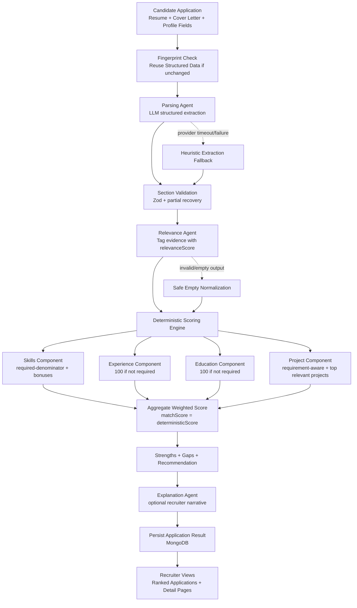

# HR-AI-Startup

Production-grade AI recruitment platform with deterministic, explainable screening and AI-assisted interviews.

## Overview

This system is designed for engineering reliability, recruiter trust, and evaluator transparency.

Core principles:
- LLMs are used for semantic extraction and relevance tagging.
- Final screening score is deterministic and reproducible.
- Every stage has validation, fallback behavior, and operational guardrails.

## Repository Structure

- [server](server): Express + TypeScript API, AI orchestration, scoring engine
- [web](web): Next.js frontend for candidates, recruiters, and admins

## Tech Stack

Frontend:
- Next.js App Router
- React + Redux Toolkit
- Axios

Backend:
- Node.js + Express
- MongoDB + Mongoose
- Zod for runtime schema validation

AI Layer:
- LangGraph for multi-step orchestration
- Gemini primary provider with fallback provider strategy
- LangSmith-ready trace patterns

## Current Screening Architecture

Pipeline flow:
1. Resume/Cover Letter intake
2. Structured parsing
3. Section-level schema validation with partial recovery
4. Relevance tagging per evidence item
5. Deterministic score calculation
6. Strengths/gaps generation
7. Recommendation generation
8. Optional explanation generation

Important implementation note:
- Final `matchScore` is deterministic.
- LLM does not directly assign the final candidate score.

### Multi-Agent Flow Diagram


Candidate Application
(Resume + Cover Letter + Profile Fields)
                |
                v
      Fingerprint Check
 (reuse structured data if unchanged)
                |
                v
        Parsing Agent (LLM)
   (structured extraction)
                |
                v
     Section Validation (Zod)
     + Partial Recovery Logic
                |
        ---------------------
        |                   |
        v                   v
Relevance Agent        Heuristic Fallback
(tag relevanceScore)   (if LLM fails)
        |                   |
        -----------+--------
                    |
                    v
      Deterministic Scoring Engine
                    |
    -----------------------------------------
    |            |            |             |
    v            v            v             v
 Skills       Experience    Education     Projects
 Component    Component     Component     Component
(required %)  (years-based) (match level) (relevant work)
    |            |            |             |
    -----------------------------------------
                    |
                    v
       Aggregate Weighted Score
     (matchScore = deterministicScore)
                    |
                    v
     Strengths + Gaps + Recommendation
                    |
                    v
        Explanation Agent (LLM)
      (optional recruiter narrative)
                    |
                    v
     Persist Result (MongoDB Database)
                    |
                    v
        Recruiter Dashboard View
 (ranked candidates + detailed insights)



## Deterministic Scoring Policy

Implemented in [server/src/services/scoring.service.ts](server/src/services/scoring.service.ts).

Scoring components:
- Skills
- Experience
- Education
- Projects

### Skills
- Uses relevance-filtered evidence (threshold-based) from:
  - skills
  - project technologies
  - certifications
- Required skills are the base denominator.
- Nice-to-have and depth act as bonus signals.
- Missing required skills are emitted as gaps.

### Experience
- If `minExperienceYears` is not specified by job: component set to 100.
- If specified: score is based on years ratio and relevance quality.

### Education
- If `educationLevel` is not specified by job: component set to 100.
- If specified: evaluated against degree/field match.

### Projects
- Project scoring is requirement-aware.
- If role does not appear to require projects/portfolio/research evidence:
  - project component is set to 100
  - project component weight is set to 0 (no penalty)
- If required:
  - relevance-filter projects
  - take top 3 by relevance
  - relevance-weighted quality aggregation
  - coverage denominator uses the configured project denominator logic in code

### Output
- `matchScore` (deterministic)
- per-component scores
- `strengths`
- `gaps`
- `overallRecommendation`
- `rawExplanation`

## AI Engineering Techniques Used

The implementation includes production-oriented AI controls:

1. Section-level validation with partial salvage
- Prevents whole-pipeline failure from one malformed section.

2. Loose JSON parse + strict schema enforcement
- Tolerates minor LLM formatting issues while enforcing final structure.

3. Multi-provider LLM failover
- Preserves availability when primary model is degraded.

4. Retry and timeout discipline
- Avoids hung model calls and improves service resilience.

5. Deterministic final decisioning
- Preserves explainability and reproducibility for recruiters.

6. Resume fingerprinting
- Avoids unnecessary recomputation and reduces cost.

7. DB fail-fast strategy
- Disables unsafe mongoose buffering behavior.
- Auth routes return explicit 503 when DB is unavailable.

8. Requirement-aware component weighting
- Avoids penalizing roles for non-required dimensions (for example projects).

## Candidate Profile Schema (Implemented)

Candidate profile supports:
- Core: `fullName`, `email`
- Optional enrichment: `firstName`, `lastName`, `headline`, `bio`, `location`
- Evidence: `skills`, `experiences`, `education`, `projects`, `certifications`
- Additional optional fields: `languages`, `availability`, `socialLinks`
- Operational metadata: `structuredExtractedAt`, `resumeFingerprint`, `structuredSource`

## Environment Variables

Backend (.env in [server](server)):
- `PORT`
- `CORS_ORIGIN`
- `MONGODB_URI`
- `MONGODB_CONNECT_RETRIES`
- `MONGODB_SERVER_SELECTION_TIMEOUT_MS`
- `MONGODB_CONNECT_TIMEOUT_MS`
- `MONGODB_SOCKET_TIMEOUT_MS`
- `JWT_SECRET`
- `JWT_EXPIRES_IN`
- `AUTH_COOKIE_DAYS`
- `GOOGLE_API_KEY`
- `CHATGROQ_API_KEY`
- `GEMINI_MODEL`
- `CHATGROQ_MODEL`
- `LLM_PROVIDER_TIMEOUT_MS`

Frontend (.env.local in [web](web)):
- `NEXT_PUBLIC_API_BASE_URL`

## Local Development

Backend:
```bash
cd server
npm install
npm run dev
```

Frontend:
```bash
cd web
npm install
npm run dev
```

Build checks:
```bash
cd server
npm run build

cd ../web
npm run build
```


## API Surface (High-Level)

Auth routes:
- `/auth/register`
- `/auth/login`
- `/auth/me`
- `/auth/profile`

Domain routes:
- `/api/jobs/*`
- `/api/applications/*`

Health check:
- `/health`

## Known Limitations

- Automated tests are not yet implemented in this repository.
- Some requirement extraction heuristics in scoring can still be further tuned by domain.
- Interview and screening explainability can be extended with requirement-level evidence attribution maps.

## Suggested Next Improvements

1. Add integration tests for end-to-end screening pipeline.
2. Add requirement-to-evidence attribution in screening results.
3. Add structured monitoring dashboards for model latency and fallback rates.
4. Add role-specific scoring presets (for example teaching, research, engineering).

## Evaluation Summary

This project demonstrates practical AI systems engineering:
- controlled LLM usage
- deterministic decisioning
- robust validation/fallback strategies
- production-aware operational behavior

It is designed to be audited, improved, and deployed incrementally by engineering teams.
