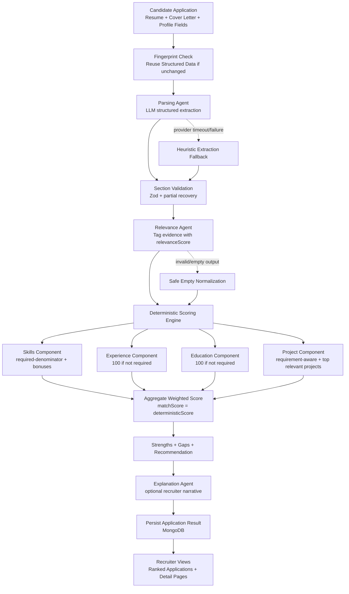

# HR Pain Solutions

An AI-assisted hiring workspace for candidate screening, structured interviews, and recruiter review. The platform combines language-model-assisted evidence extraction with deterministic candidate scoring so teams can inspect how a recommendation was produced.

> Screening scores support recruiter review; they are not a substitute for human judgment.

## Product Overview

- Candidates create a profile, apply to roles, and complete structured interviews.
- Recruiters manage jobs, review ranked applications, and configure interview criteria.
- Administrators can review platform activity.
- Screening uses AI for structured extraction and relevance tagging; the final match score is calculated deterministically from job criteria.

## Repository Layout

| Path | Purpose |
| --- | --- |
| `server/` | Express API, MongoDB models, authentication, screening, and interview services |
| `web/` | Next.js application for candidates, recruiters, and administrators |
| `scripts/` | Local operational utilities |

## Technology

- **Web:** Next.js 16, React 19, TypeScript, Redux Toolkit, Tailwind CSS
- **API:** Node.js, Express 5, TypeScript, Mongoose, Zod
- **AI orchestration:** LangGraph, Gemini, Groq fallback, and LangSmith-compatible tracing
- **Data:** MongoDB

## Screening Architecture

Pipeline flow:
1. Resume/Cover Letter intake
2. Structured parsing
3. Section-level schema validation with partial recovery
4. Relevance tagging per evidence item
5. Deterministic score calculation
6. Strengths/gaps generation
7. Recommendation generation
8. Optional explanation generation

Important implementation note:
- Final `matchScore` is deterministic.
- LLM does not directly assign the final candidate score.



## Deterministic Scoring Policy

Implemented in [server/src/services/scoring.service.ts](server/src/services/scoring.service.ts).

Scoring components:
- Skills
- Experience
- Education
- Projects

### Skills
- Uses relevance-filtered evidence (threshold-based) from:
  - skills
  - project technologies
  - certifications
- Required skills are the base denominator.
- Nice-to-have and depth act as bonus signals.
- Missing required skills are emitted as gaps.

### Experience
- If `minExperienceYears` is not specified by job: component set to 100.
- If specified: score is based on years ratio and relevance quality.

### Education
- If `educationLevel` is not specified by job: component set to 100.
- If specified: evaluated against degree/field match.

### Projects
- Project scoring is requirement-aware.
- If role does not appear to require projects/portfolio/research evidence:
  - project component is set to 100
  - project component weight is set to 0 (no penalty)
- If required:
  - relevance-filter projects
  - take top 3 by relevance
  - relevance-weighted quality aggregation
  - coverage denominator uses the configured project denominator logic in code

### Output
- `matchScore` (deterministic)
- per-component scores
- `strengths`
- `gaps`
- `overallRecommendation`
- `rawExplanation`

## AI Engineering Techniques Used

The implementation includes production-oriented AI controls:

1. Section-level validation with partial salvage
- Prevents whole-pipeline failure from one malformed section.

2. Loose JSON parse + strict schema enforcement
- Tolerates minor LLM formatting issues while enforcing final structure.

3. Multi-provider LLM failover
- Preserves availability when primary model is degraded.

4. Retry and timeout discipline
- Avoids hung model calls and improves service resilience.

5. Deterministic final decisioning
- Preserves explainability and reproducibility for recruiters.

6. Resume fingerprinting
- Avoids unnecessary recomputation and reduces cost.

7. DB fail-fast strategy
- Disables unsafe mongoose buffering behavior.
- Auth routes return explicit 503 when DB is unavailable.

8. Requirement-aware component weighting
- Avoids penalizing roles for non-required dimensions (for example projects).

## Candidate Profile Schema (Implemented)

Candidate profile supports:
- Core: `fullName`, `email`
- Optional enrichment: `firstName`, `lastName`, `headline`, `bio`, `location`
- Evidence: `skills`, `experiences`, `education`, `projects`, `certifications`
- Additional optional fields: `languages`, `availability`, `socialLinks`
- Operational metadata: `structuredExtractedAt`, `resumeFingerprint`, `structuredSource`

## Environment Variables

Create `server/.env` and `web/.env.local` locally. These files are ignored by Git; never commit real credentials.

| Variable | Service | Required / default |
| --- | --- | --- |
| `MONGODB_URI` | API | Required for database-backed features |
| `JWT_SECRET` | API | Required for authentication; use a long, unique random value |
| `GOOGLE_API_KEY` | API | Credential for Gemini-powered features |
| `CHATGROQ_API_KEY` | API | Credential for Groq fallback features |
| `PORT` | API | Optional; defaults to `4000` |
| `CORS_ORIGIN` | API | Optional; defaults to `http://localhost:3000` |
| `MONGODB_CONNECT_RETRIES` | API | Optional; defaults to `5` |
| `MONGODB_SERVER_SELECTION_TIMEOUT_MS` | API | Optional; defaults to `10000` |
| `MONGODB_CONNECT_TIMEOUT_MS` | API | Optional; defaults to `10000` |
| `MONGODB_SOCKET_TIMEOUT_MS` | API | Optional; defaults to `30000` |
| `JWT_EXPIRES_IN` | API | Optional; defaults to `30d` |
| `AUTH_COOKIE_DAYS` | API | Optional; defaults to `30` |
| `GEMINI_MODEL` | API | Optional; defaults to `gemini-2.5-flash` |
| `CHATGROQ_MODEL` | API | Optional; defaults to `llama-3.3-70b-versatile` |
| `LLM_PROVIDER_TIMEOUT_MS` | API | Optional; defaults to `12000` |
| `NEXT_PUBLIC_API_BASE_URL` | Web | Optional; defaults to `http://localhost:4000` |

## Local Development

### Prerequisites

- Node.js 20.9 or later and npm
- MongoDB connection string for database-backed workflows
- AI provider credentials for screening and interview features

### Configure

Add the following to `server/.env`, replacing placeholders with local values:

```bash
PORT=4000
CORS_ORIGIN=http://localhost:3000
MONGODB_URI=mongodb://127.0.0.1:27017/hr_solutions
JWT_SECRET=replace-with-a-long-random-secret
GOOGLE_API_KEY=replace-with-your-google-ai-key
CHATGROQ_API_KEY=replace-with-your-groq-key
```

For local web development, `NEXT_PUBLIC_API_BASE_URL` may be omitted when the API runs on port `4000`. Set it in `web/.env.local` when the API uses a different address.

### Run

Open two terminals from the repository root:

```bash
# Terminal 1: API
cd server
npm ci
npm run dev
```

```bash
# Terminal 2: web app
cd web
npm ci
npm run dev
```

Open `http://localhost:3000`. The API health check is available at `http://localhost:4000/health`.

## Deployment

The application can be deployed with the web app on Vercel and the API on Render. MongoDB Atlas provides the production database.

### 1. Deploy the API to Render

1. Create a MongoDB Atlas database, allow connections from Render, and copy its connection string. Render's free outbound IPs may change; if you allow `0.0.0.0/0` in Atlas, use a strong database password.
2. In Render, create a Blueprint from this GitHub repository and apply the root-level `render.yaml`.
3. Set `MONGODB_URI` in the Render service to the Atlas connection string. Render generates `JWT_SECRET`; optionally add `GOOGLE_API_KEY` and `CHATGROQ_API_KEY` in the Render service environment for AI features.
4. After the service deploys, copy its public URL, for example `https://hr-solutions-api.onrender.com`.
5. Check that opening `<Render URL>/health` returns a healthy response.

### 2. Deploy the web app to Vercel

1. Import the same GitHub repository into Vercel and set the Root Directory to `web`.
2. Add these environment variables for the Production environment:

   | Variable | Value |
   | --- | --- |
   | `NEXT_PUBLIC_API_BASE_URL` | `/api-backend` |
   | `API_REWRITE_DESTINATION` | The Render API URL from step 4, such as `https://hr-solutions-api.onrender.com` |

3. Deploy the app and open its public URL to verify registration, login, and API access.

The `/api-backend` rewrite keeps API requests and authentication cookies on the web app's origin. The local development setup continues to use `http://localhost:4000`.

**Free-tier note:** Render's free service may sleep when idle, so the first API request can be delayed. Uploaded profile images and company logos are stored on the API filesystem and may not survive a free-service restart or redeploy. Use persistent or object storage before relying on those uploads in production.

### Production Builds

Run the TypeScript API build and Next.js production build independently:

```bash
cd server && npm run build
cd ../web && npm run build
```

## API Surface (High-Level)

Auth routes:
- `/auth/register`
- `/auth/login`
- `/auth/me`
- `/auth/profile`

Domain routes:
- `/api/jobs/*`
- `/api/applications/*`

Health check:
- `/health`
- `/health`
## Project Demo

[Watch the project demo on YouTube](https://youtu.be/K4dM0FedN7k).

## Project Status

- Automated test coverage is not yet configured.
- Scoring heuristics and requirement-level evidence attribution can be extended as domain needs evolve.
- Treat AI-generated extraction and interview feedback as decision support; review outcomes before taking hiring action.
